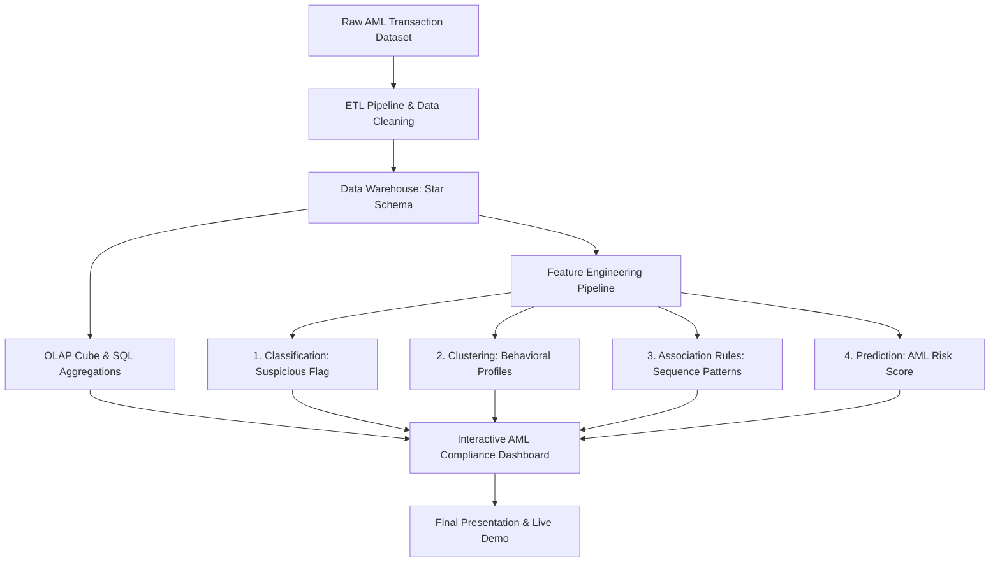

# Anti-Money Laundering (AML) Analytics & Detection Platform
## Comprehensive Project Implementation Plan

---

### Project Overview & Requirement Mapping

Based on the course requirements matrix, the project requires an end-to-end data warehousing, OLAP, and data mining pipeline tailored to **Anti-Money Laundering (AML)**.

| Component | Rubric Requirement | Planned Implementation |
| :--- | :--- | :--- |
| **1. Dataset Description** | Required (`Yes`) | Financial AML transaction dataset (e.g., IBM AMLSim / Synthetic Financial AML / PaySim) with accounts, transactions, currencies, flags, and entity metadata. |
| **2. Data Warehouse (DW)** | Required (`Yes`) | Star / Snowflake Schema in PostgreSQL / SQLite / DuckDB featuring a centralized Fact table and comprehensive Dimension tables. |
| **3. OLAP Operations** | Required (`Yes`) | SQL & Multidimensional aggregation scripts demonstrating **Roll-up**, **Drill-down**, **Slice**, **Dice**, and **Pivot**. |
| **4. Classification** | *Classify suspicious / non-suspicious* | Supervised ML models (XGBoost, Random Forest, LightGBM) to detect illicit/suspicious transactions with class imbalance handling. |
| **5. Clustering** | *Cluster transaction behavior groups* | Unsupervised learning (K-Means, DBSCAN) to discover transaction behavioral profiles (e.g., smurfing, dormant pass-through, high-velocity). |
| **6. Association Rules** | *Suspicious transaction sequence rules* | Frequent pattern mining (FP-Growth / Apriori) to discover multi-step money laundering sequence signatures and co-occurring behaviors. |
| **7. Prediction** | *Predict AML risk score* | Regression & Probability calibration model computing continuous risk scores ($0 - 100$) for accounts/transactions. |
| **8. Dashboard** | Required (`Yes`) | Interactive Web Dashboard (Streamlit / Next.js / Dash) with real-time risk scoring, alert triage, OLAP explorer, and visual analytics. |
| **9. Project Demo** | Required (`Yes`) | Live demonstration script showcasing ETL $\to$ OLAP $\to$ ML Models $\to$ Interactive Dashboard. |

---

## 🏗️ Phase-by-Phase Execution Roadmap



---

### Phase 1: Dataset Selection & Schema Design

#### 1.1 Recommended Datasets
- **IBM AML Transactions Dataset / Kaggle AML Synthetic Dataset**:
  - Features: `Timestamp`, `From_Account`, `To_Account`, `Amount`, `Currency`, `Payment_Format` (Wire, ACH, Cash, Cheque), `Is_Laundering` (binary label), `Laundering_Type` (Fan-Out, Fan-In, Cycle, Scatter-Gather).

#### 1.2 Data Warehouse Architecture (Star Schema)
- **Fact Table**: `Fact_Transactions`
  - `transaction_id` (PK)
  - `date_key` (FK $\to$ `Dim_Date`)
  - `sender_account_key` (FK $\to$ `Dim_Account`)
  - `receiver_account_key` (FK $\to$ `Dim_Account`)
  - `channel_key` (FK $\to$ `Dim_Channel`)
  - `location_key` (FK $\to$ `Dim_Location`)
  - Measures: `amount_usd`, `fee_amount`, `velocity_24h`, `is_flagged_sar`, `is_laundering`
- **Dimension Tables**:
  - `Dim_Account`: `account_id`, `customer_type` (Individual/Corporate), `risk_rating`, `account_age_months`, `country`.
  - `Dim_Date`: `date_key`, `full_date`, `day`, `month`, `quarter`, `year`, `is_weekend`, `is_holiday`.
  - `Dim_Channel`: `channel_id`, `payment_method` (Cash Deposit, Wire, Crypto On-Ramp, Swift, ATM), `is_cross_border`.
  - `Dim_Location`: `location_id`, `origin_country`, `destination_country`, `tax_haven_flag`, `high_risk_jurisdiction_flag`.

---

### Phase 2: OLAP Operations Implementation

Prepare explicit queries demonstrating core OLAP primitives:
1. **Roll-up**: Aggregate total illicit transaction volume from Daily $\to$ Monthly $\to$ Quarterly $\to$ Yearly.
2. **Drill-down**: Navigate from Global Risk Volume $\to$ Specific Region/Country $\to$ Specific Branch / Transfer Channel.
3. **Slice**: Filter transactions for high-risk offshore channels (e.g., `is_cross_border = True AND payment_method = 'Wire'`).
4. **Dice**: Restrict analysis across multiple dimensions (e.g., `Year = 2024`, `Amount > $10,000`, `Origin_Country IN ('High-Risk List')`).
5. **Pivot**: Pivot total suspicious transaction volumes across `Payment_Method` (rows) versus `Customer_Type` (columns).

---

### Phase 3: Data Mining & Machine Learning Modules

#### 3.1 Classification (Suspicious vs. Normal)
- **Objective**: Accurately classify individual transactions as `Suspicious` (SAR trigger) vs `Normal`.
- **Techniques**: LightGBM, XGBoost, Random Forest.
- **Key Focus**: Imbalanced learning (SMOTE, Focal Loss, or class weighting), threshold tuning, feature importance (SHAP values).
- **Evaluation**: ROC-AUC, PR-AUC, Recall@Top-K, F1-Score.

#### 3.2 Clustering (Transaction Behavior Groups)
- **Objective**: Discover latent behavioral archetypes among customers and transactions.
- **Features**: Velocity (tx count per hour/day), standard deviation of amounts, ratio of round-dollar transactions, in-to-out fund ratio.
- **Algorithms**: K-Means, DBSCAN, or Agglomerative Hierarchical Clustering.
- **Identified Clusters**:
  1. *Smurfing / Structuring*: Frequent sub-$10k cash deposits.
  2. *Rapid Pass-Through*: Inflow followed immediately by equivalent outflow.
  3. *Dormant Burst*: Accounts inactive for months suddenly moving large sums.
  4. *Standard Retail Consumer*: Regular salaries and low-variance retail spending.

#### 3.3 Association Rule Mining (Transaction Sequence Rules)
- **Objective**: Detect frequent suspicious multi-step sequences or co-occurring risk indicators.
- **Algorithms**: FP-Growth / Apriori (using `mlxtend`).
- **Sample Rules Discovered**:
  - `{Cash Deposit < $10k, ATM Location X} => {Immediate Cross-Border Wire}` (Conf: $88\%$, Lift: $4.2$)
  - `{New Device Login, High-Risk Country IP} => {Rapid Full-Balance Transfer}` (Conf: $92\%$, Lift: $5.6$)

#### 3.4 Prediction (AML Risk Score)
- **Objective**: Compute a continuous AML Risk Score ($0 - 100$) for each transaction / account.
- **Model**: Ensembled Regressor / Calibrated Probability Model combining:
  - Account Profile Risk (PEP status, jurisdiction, historical SARs)
  - Behavioral Anomaly Deviation from cluster centroid
  - Classification likelihood of laundering
- **Output**: Calibrated risk score with breakdown factors (e.g., Score $87/100$: $40\%$ velocity surge, $30\%$ high-risk jurisdiction, $30\%$ structuring behavior).

---

### Phase 4: Interactive Compliance & Analytics Dashboard

Develop a modern web interface (Streamlit or React/Next.js) with:
1. **Executive Overview**: Total processed transactions, AML alert volume, flagged SAR amounts, and alert conversion rate.
2. **Interactive OLAP Cube Explorer**: Interactive dropdowns for Roll-up, Slice, Dice, and Pivot tables with visual charts.
3. **Real-time SAR Alert & Risk Scoring Engine**: Enter or simulate incoming transactions and get instant 0–100 Risk Scores with SHAP feature explanations.
4. **Behavioral Cluster Visualizer**: 2D/3D PCA/t-SNE cluster scatter plots explaining transaction behavior groups.
5. **Pattern & Sequence Graph Explorer**: Visual flow of money laundering sequences and association rules.

---

### Phase 5: Demo & Final Presentation Preparation

- **Live Scenario 1**: Demonstrate ETL ingestion and querying the Data Warehouse using OLAP operations.
- **Live Scenario 2**: Run an incoming batch of transactions through the ML models — show Classification, Cluster tagging, and Risk Score generation.
- **Live Scenario 3**: Trigger a detected suspicious pattern (Structuring / Smurfing) discovered via Association Rules.
- **Live Scenario 4**: Open the Interactive Dashboard to inspect alerts, filter with OLAP, and generate a sample SAR report.

---

### 📂 Recommended Project Directory Structure

```text
anti-money-laundering/
├── data/
│   ├── raw/                 # Raw transaction datasets
│   └── processed/           # Cleaned and transformed data
├── warehouse/
│   ├── schema.sql           # Star Schema DDL (Fact & Dimension tables)
│   ├── etl_pipeline.py      # Extract, Transform, Load into DW
│   └── olap_queries.sql     # Roll-up, Drill-down, Slice, Dice, Pivot
├── models/
│   ├── 1_classification.py  # Suspicious vs Non-Suspicious classifier
│   ├── 2_clustering.py      # Transaction behavior group clustering
│   ├── 3_association.py     # Suspicious transaction sequence rules
│   └── 4_prediction.py      # AML Risk Score predictor
├── dashboard/
│   └── app.py               # Interactive Streamlit / Web UI
├── notebooks/               # Exploratory data analysis (EDA)
├── requirements.txt         # Python dependencies
└── README.md                # Project documentation & execution guide
```
